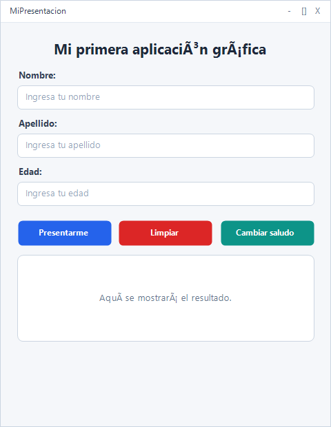
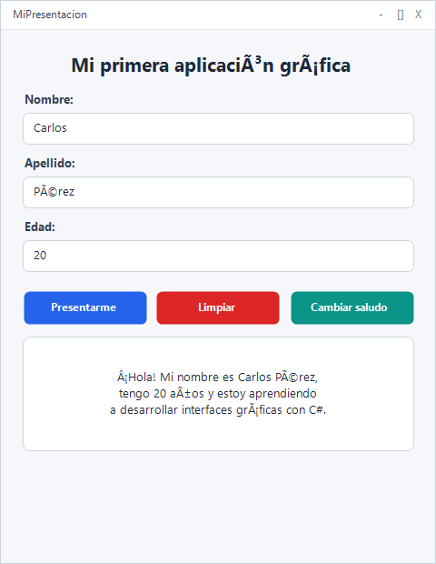
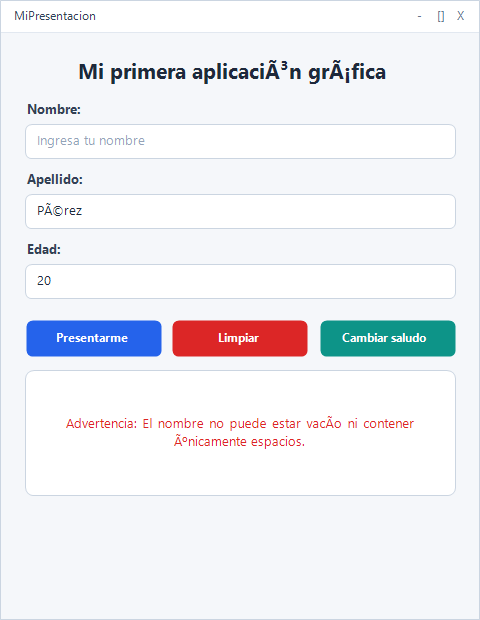
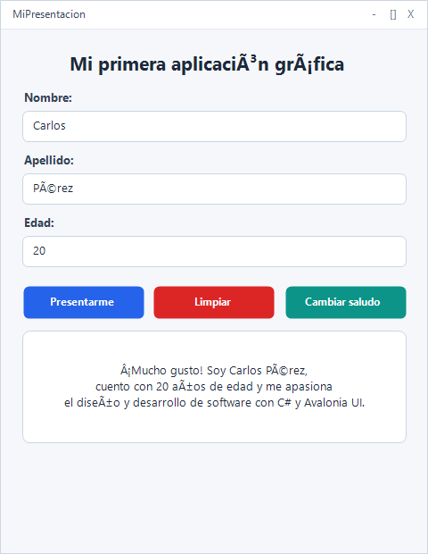

# MiPresentacion

Aplicación de escritorio desarrollada con **Avalonia UI 11** y **.NET 8 (C#)** que permite registrar los datos básicos de una persona (nombre, apellido y edad), validar la información introducida y generar una presentación personalizada mediante una interfaz gráfica moderna orientada a eventos.

---

## 1. Descripción de la aplicación

La aplicación **MiPresentacion** ha sido diseñada para una institución educativa con el propósito de demostrar la integración entre el diseño declarativo en **XAML** y la lógica de programación orientada a objetos y eventos en **C#**.

La aplicación ofrece:
- Captura de información personal a través de campos de entrada organizados.
- Validación estricta de datos (campos requeridos, formato numérico entero y edad positiva mayor a cero).
- Visualización dinámica del mensaje de presentación con formato personalizado.
- Limpieza y reinicio rápido del formulario con reubicación automática del foco del cursor.
- Alternancia de mensajes de presentación en tiempo real (Reto adicional).

---

## 2. Tecnologías utilizadas

- **C# 12**
- **.NET 8.0 SDK**
- **Avalonia UI 11 (11.1.3)**
- **Fluent Theme para Avalonia**

---

## 3. Estructura del proyecto

El proyecto conserva la siguiente organización de archivos:

```text
MiPresentacion/
│
├── capturas/
│   ├── 01_formulario_inicial.png
│   ├── 02_presentacion_exitosa.png
│   ├── 03_validacion_advertencia.png
│   └── 04_reto_cambiar_saludo.png
├── App.axaml
├── App.axaml.cs
├── MainWindow.axaml
├── MainWindow.axaml.cs
├── MiPresentacion.csproj
├── Program.cs
├── app.manifest
├── .gitignore
└── README.md
```

---

## 4. Explicación de los controles utilizados en XAML

En el archivo `MainWindow.axaml` se estructuran los siguientes controles visuales:

- **Window**: Ventana principal de la aplicación, configurada con dimensiones fijas (`480x600`), título personalizado y centrada en pantalla mediante `WindowStartupLocation="CenterScreen"`.
- **Border**: Proporciona márgenes internos (`Padding`), bordes redondeados y fondos contrastantes para separar visualmente las secciones del formulario y la tarjeta de resultados.
- **StackPanel**: Contenedor de distribución vertical y horizontal que organiza los controles secuencialmente, aplicando las propiedades `Spacing` y `Margin` para una separación armónica.
- **TextBlock**:
  - Título principal: Muestra el texto «Mi primera aplicación gráfica» con tipografía destacada.
  - Etiquetas de campo: Indican al usuario la información solicitada en cada entrada (Nombre, Apellido, Edad).
  - Control de resultado (`x:Name="txtResultado"`): Área donde se despliegan los mensajes de presentación o las advertencias de validación con ajuste automático de línea (`TextWrapping="Wrap"`).
- **TextBox**:
  - `txtNombre`: Caja de texto para el ingreso del nombre con marca de agua (`Watermark="Ingresa tu nombre"`).
  - `txtApellido`: Caja de texto para el ingreso del apellido con marca de agua (`Watermark="Ingresa tu apellido"`).
  - `txtEdad`: Caja de texto para el ingreso de la edad con marca de agua (`Watermark="Ingresa tu edad"`).
- **Button**:
  - `btnPresentarme`: Botón con el texto «Presentarme» que dispara la validación y genera la presentación.
  - `btnLimpiar`: Botón con el texto «Limpiar» que restaura los valores por defecto del formulario.
  - `btnCambiarSaludo`: Botón correspondiente al reto adicional con el texto «Cambiar saludo» que conmuta el estilo del mensaje.

---

## 5. Funcionamiento de la programación orientada a eventos en C#

La interacción de la interfaz gráfica se gestiona en `MainWindow.axaml.cs` a través de controladores de eventos asociados a los botones:

### Botón Presentarme (`BtnPresentarme_Click`)
1. Obtiene los valores ingresados en `txtNombre`, `txtApellido` y `txtEdad`.
2. Ejecuta el método de validación `ValidarCampos()`:
   - Verifica que el nombre no sea nulo, vacío ni contenga únicamente espacios en blanco (`string.IsNullOrWhiteSpace()`).
   - Verifica que el apellido no sea nulo, vacío ni contenga únicamente espacios en blanco.
   - Comprueba mediante `int.TryParse()` que la edad corresponda a un número entero válido sin letras ni caracteres especiales.
   - Valida que la edad sea un entero estrictamente positivo (`edad > 0`).
3. Si los datos son válidos, construye el mensaje de saludo y lo asigna a `txtResultado.Text` con color de texto principal.
4. Si algún dato es inválido, muestra la advertencia correspondiente en color rojo y asigna el foco del teclado al campo con error.

### Botón Limpiar (`BtnLimpiar_Click`)
1. Vacía las cajas de texto `txtNombre.Text`, `txtApellido.Text` y `txtEdad.Text`.
2. Restaura el texto inicial en `txtResultado.Text` («Aquí se mostrará el resultado.») y su color neutro.
3. Posiciona el cursor en la primera caja de texto invocando `txtNombre.Focus()`.

### Botón Cambiar Saludo (`BtnCambiarSaludo_Click` — Reto adicional)
1. Invierte el valor del indicador booleano `_saludoAlternativo`.
2. Si los campos actuales contienen información válida, regenera inmediatamente la presentación visualizando el estilo alterno sin recargar ni cerrar la ventana.
3. Si el formulario no ha sido completado, notifica el estilo de saludo que ha quedado activo para la siguiente presentación.

---

## 6. Casos de prueba y validación

| Caso | Datos introducidos | Resultado esperado | Comportamiento en la aplicación |
| :---: | :--- | :--- | :--- |
| **1** | Nombre, apellido y edad válidos | Muestra la presentación | Despliega el mensaje formateado con los datos del usuario. |
| **2** | Nombre vacío | Muestra una advertencia | Muestra «Advertencia: El nombre no puede estar vacío ni contener únicamente espacios.» y enfoca `txtNombre`. |
| **3** | Apellido vacío | Muestra una advertencia | Muestra «Advertencia: El apellido no puede estar vacío ni contener únicamente espacios.» y enfoca `txtApellido`. |
| **4** | Edad con letras | Solicita una edad numérica | Muestra «Advertencia: Por favor ingresa una edad numérica válida. No se permiten letras ni símbolos.» y enfoca `txtEdad`. |
| **5** | Edad negativa o igual a cero | Rechaza la edad | Muestra «Advertencia: Edad inválida. La edad debe ser un número entero positivo mayor a cero.» y enfoca `txtEdad`. |
| **6** | Presionar Limpiar | Restablece el formulario | Vacía los tres TextBox, restablece el mensaje inicial y coloca el cursor en `txtNombre`. |

---

## 7. Reto adicional implementado

Se incluyó el botón **Cambiar saludo** (`btnCambiarSaludo`), el cual permite alternar entre dos formatos de presentación:

- **Formato Predeterminado:**
  ```text
  ¡Hola! Mi nombre es [Nombre] [Apellido],
  tengo [Edad] años y estoy aprendiendo
  a desarrollar interfaces gráficas con C#.
  ```

- **Formato Alternativo:**
  ```text
  ¡Mucho gusto! Soy [Nombre] [Apellido],
  cuento con [Edad] años de edad y me apasiona
  el diseño y desarrollo de software con C# y Avalonia UI.
  ```

La conmutación se realiza en memoria en tiempo de ejecución conservando el estado de la aplicación.

---

## 8. Instrucciones de compilación y ejecución

### Prerrequisitos
- Tener instalado el SDK de .NET 8.0 o superior.

### Pasos para ejecutar:
1. Abrir una terminal en el directorio del proyecto:
   ```bash
   cd MiPresentacion
   ```
2. Restaurar dependencias del proyecto:
   ```bash
   dotnet restore
   ```
3. Compilar la aplicación:
   ```bash
   dotnet build
   ```
4. Ejecutar la aplicación:
   ```bash
   dotnet run
   ```

---

## 9. Evidencias y capturas de pantalla

### Estado inicial del formulario


### Caso 1: Presentación correcta


### Caso 2 a 5: Validación de datos y advertencia


### Reto adicional: Alternancia de saludo


